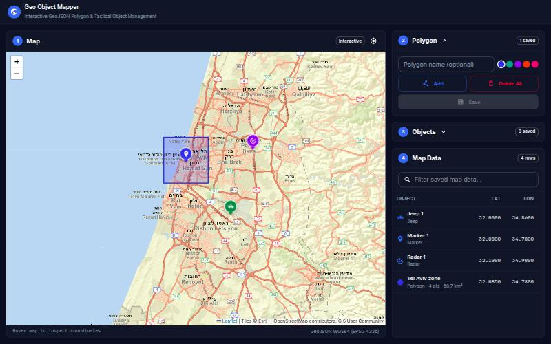

# Geo Object Mapper

A client-server application for managing polygons and objects on an interactive map. Polygons are drawn on a Leaflet map, objects are placed as markers or custom symbols such as a jeep, and everything is stored in MongoDB as GeoJSON through a REST API.



| Layer | Technology |
|---|---|
| Client | React 19, TypeScript, Vite, Leaflet, MUI, Zustand |
| Server | ASP.NET Core 8 REST API, MediatR, FluentValidation |
| Database | MongoDB 7 with `2dsphere` indexes |

## Quick start

The only requirement is Docker.

```bash
docker compose up --build
```

| What | Where |
|---|---|
| Application | http://localhost:5173 |
| Swagger | http://localhost:5000/swagger |
| Health | http://localhost:5000/health/ready |

Ports 5000 and 5173 must be free. Data stays in a Docker volume between runs, and `docker compose down -v` removes it.

## How to use it

1. **Polygon:** click Add, click the map to create vertices, then click the green starting point to close the shape. Click Save to store it.
2. **Objects:** choose Marker, Jeep, Radar or Drone, click Add, then click the map. Click Done when finished and Save to store the list.
3. **Delete:** select an item on the map or in the table, then click Delete. With nothing selected the button becomes Delete All and asks for confirmation.

## Requirements

| Requirement | Status | Where |
|---|---|---|
| Four panels: Map, Polygon, Objects, Map Data | Done | `frontend/src/modules/map/views/MapWorkspaceView.tsx` |
| Polygon Add: draw on the map, close on the starting point | Done | `frontend/src/modules/map/components/MapCanvasController.tsx` |
| Polygon Save with POST, stored in MongoDB | Done | `frontend/src/modules/polygons/hooks/polygon.crud.ts`, `PolygonsController` |
| Polygon Delete: selected or all, with DELETE | Done | `polygon.crud.ts`, `PolygonsController` |
| Object Add as a Marker or custom Symbol | Done | `frontend/src/modules/objects/`, `frontend/src/modules/map/utils/leafletIcons.utils.ts` |
| Object Save with POST | Done | `frontend/src/modules/objects/hooks/geoObject.crud.ts`, `ObjectsController` |
| Object Delete with DELETE | Done | `geoObject.crud.ts`, `ObjectsController` |
| Map Data table with Object / Lat / Lon, updated after Save | Done | `frontend/src/modules/map/components/MapDataPanel.tsx` |
| REST API for Create, Read, Delete | Done | `backend/src/GeoObjectMapper.Api/Controllers/` |
| Data stored as GeoJSON | Done | `backend/src/GeoObjectMapper.Infrastructure/Persistence/` |
| Updated data returned after Save | Done | The API returns the saved entities with their ids and timestamps |

## API

Successful responses use the envelope `{ "message": string, "data": ... }`. Errors use `ProblemDetails`.

| Method | Route | Purpose |
|---|---|---|
| GET | `/api/polygons`, `/api/objects` | List all |
| GET | `/api/polygons/{id}`, `/api/objects/{id}` | Get one |
| POST | `/api/polygons`, `/api/objects` | Create one |
| POST | `/api/polygons/batch`, `/api/objects/batch` | Create a list |
| PUT | `/api/polygons/{id}`, `/api/objects/{id}` | Update, requires the current `timestamp` |
| DELETE | `/api/polygons/{id}`, `/api/objects/{id}` | Delete one |
| DELETE | `/api/polygons`, `/api/objects` | Delete all |

## Key decisions

- **Drafts stay in the client until Save.** Drawing and placing never call the server, so the table shows only what MongoDB holds and the map marks unsaved items.
- **The server has the final say on geometry.** Validators check the ring structure, and the `2dsphere` index rejects shapes such as self-crossing polygons. That rejection is returned as a 400 with a clear message.
- **Updates use optimistic concurrency.** A write only matches the stored timestamp, so two editors get a 409 instead of a silent overwrite.
- **Layered backend.** Domain, Application, Infrastructure and Api keep Mongo out of the business rules, and validation and logging run in one MediatR pipeline. This is more structure than two entities strictly need, and I would use fewer layers for a service that will stay this small.

## Assumptions

- A polygon has one row in Map Data, and its Lat and Lon are the centroid of the shape.
- Names are optional. Empty names become `Polygon 1`, `Jeep 2` and so on.
- Authentication was not requested, so the API is open.
- Radar and Drone are extra examples of custom symbols.

## Beyond the brief

Saved items can be renamed, polygons can be reshaped by dragging vertices, and objects can be moved by dragging. The table has a filter and centers the map on a clicked row. Light and dark themes follow the system setting.

## Edge cases handled

- Closing a polygon with fewer than three vertices is blocked, and the last vertex can be undone.
- A failed load shows an error with Retry in Map Data instead of an empty table.
- If one polygon in a batch is invalid, polygons already written from that batch are removed.
- Invalid coordinates, unknown symbols, wrong geometry types, bad colors and malformed bodies return a 400.
- The map stays inside one world, and points dropped past its edge are kept at the edge.
- When MongoDB is unreachable the API answers with a 503 after 5 seconds, and the UI offers Retry.
- A filter with no matches says so, instead of claiming nothing is saved.
- Deleting an item that is already gone refreshes it from the server.

## Testing

| Suite | Command | Covers |
|---|---|---|
| Frontend | `cd frontend && npm ci && npm test` | Geometry helpers, drawing flow, Map Data states |
| Backend | `cd backend && dotnet test` | Geometry rules, validators, update conflicts |

The frontend also has `npm run lint` and `npm run type-check`. There are no automated tests against a real MongoDB yet. That flow was checked by hand in the browser.

## Known limitations and next steps

- Polygons cannot cross the date line, because the map shows a single world.
- A polygon whose points all lie on one line is accepted, although it has no area.
- Batch writes are not transactional. Objects have no compensating cleanup, and transactions would need a replica set.
- Next I would add integration tests against MongoDB and pagination for the list endpoints.

## Local development

Requires .NET 8, Node 22 and MongoDB on `localhost:27017`.

```bash
cd backend/src/GeoObjectMapper.Api && dotnet run
```

```bash
cd frontend && npm ci && npm run dev
```

On Linux, `./run geo` starts all three, with MongoDB in Docker.

More detail is in [backend/README.md](backend/README.md) and [frontend/README.md](frontend/README.md).
